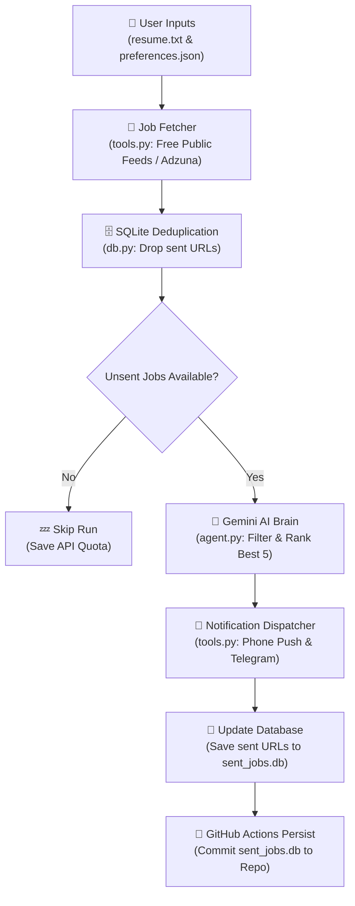

# 🚀 JobPulse: Autonomous Daily Job & Internship Digest Agent

[](https://www.python.org/)
[](https://aistudio.google.com/)
[]()
[]()
[]()

> **JobPulse** is a lightweight, production-grade AI agent that runs every morning, fetches fresh developer and internship openings matching your specific resume and preferences, filters out duplicates, and delivers the top 5 curated matches directly to your phone.

---

## 📌 Features

* 🧠 **Gemini AI Matching Engine**: Evaluates unstructured resume text against live job descriptions using `gemini-3.6-flash` with structured Pydantic JSON output.
* 🛡️ **Zero Duplicate Memory**: Backed by a local SQLite database (`sent_jobs.db`) to ensure you never receive the same job alert twice.
* 🌐 **100% Free Live Feeds**: Seamlessly queries live tech job feeds out-of-the-box (no job API key required), with full support for Adzuna India API.
* 🔒 **Built-in PII Privacy Shield**: Automatically redacts sensitive phone numbers and emails from your resume before sending prompts to the LLM.
* 📲 **Instant Phone Delivery**: Pushes clean, formatted digests directly to your mobile device via **ntfy.sh** (zero accounts needed) or **Telegram Bot API**.
* ⏰ **Fully Automated Cloud Cron**: Runs autonomously every day at **8:00 AM IST** via GitHub Actions with self-committing database persistence.

---

## 🏗️ Architecture



---

## 📂 Project Structure

```text
jobpulse-agent/
├── agent.py                 # Core agent loop: loading, matching, ranking, and alerts
├── tools.py                 # Fetching jobs, Telegram delivery, and ntfy push dispatcher
├── db.py                    # SQLite database helpers for memory and deduplication
├── resume.txt               # Candidate profile text (sanitized of personal PII)
├── preferences.json         # Search criteria (roles, locations, stipend rules)
├── sent_jobs.db             # SQLite database storing previously sent job URLs
├── requirements.txt         # Core dependencies (google-genai, requests, python-dotenv, pytest)
├── .env.example             # Clean environment variable template
├── .gitignore               # Protects secrets, cache, and virtual environments
├── README.md                # Comprehensive project documentation
├── tests/                   # 21 unit tests with fully mocked API calls
│   ├── test_agent.py        # Tests for AI ranking, JSON validation, retry, and PII scrubbing
│   ├── test_db.py           # Tests for SQLite table creation, deduplication, and idempotency
│   └── test_tools.py        # Tests for job fetching and notification dispatchers
└── .github/workflows/
    └── daily.yml            # GitHub Actions cron workflow (Runs 8:00 AM IST daily)
```

---

## 🔑 How to Get Your API Keys

### 1. Google Gemini API Key (100% Free)
1. Go to [Google AI Studio](https://aistudio.google.com/).
2. Sign in with your Google account and click **Get API key**.
3. Create a free key (no credit card required).

### 2. Phone Push Notifications (ntfy.sh - Zero Setup, No Keys)
1. Install the free **ntfy** app on your phone:
   * [ntfy for Android (Google Play)](https://play.google.com/store/apps/details?id=io.heckel.ntfy)
   * [ntfy for iOS (App Store)](https://apps.apple.com/us/app/ntfy/id1625396347)
2. Open the app, tap **+**, and subscribe to:
   ```text
   jobpulse-sriram-chityala
   ```
   *(Or inspect notifications directly in your browser at [https://ntfy.sh/jobpulse-sriram-chityala](https://ntfy.sh/jobpulse-sriram-chityala))*.

### 3. Telegram Bot (Optional)
1. Open Telegram, search for `@BotFather`, and send `/newbot` to get your `TELEGRAM_BOT_TOKEN`.
2. Search for `@userinfobot`, press **Start**, and note your numeric `Id` as `TELEGRAM_CHAT_ID`.

---

## 💻 Local Setup & Execution

### 1. Clone & Set Up Virtual Environment

```bash
# Clone the repository
git clone https://github.com/chityalasriram7522/jobpulse-agent.git
cd jobpulse-agent

# Create virtual environment
python -m venv .venv

# Activate virtual environment
# Windows:
.\.venv\Scripts\activate
# Linux/macOS:
source .venv/bin/activate

# Install dependencies
pip install -r requirements.txt
```

### 2. Configure Environment Variables
Create a `.env` file in the project root:

```env
GEMINI_API_KEY=your_actual_gemini_api_key_here
GEMINI_MODEL=gemini-3.6-flash
NTFY_TOPIC=jobpulse-sriram-chityala

# Optional Adzuna credentials (free public feeds used automatically if omitted):
ADZUNA_APP_ID=
ADZUNA_APP_KEY=

# Optional Telegram credentials:
TELEGRAM_BOT_TOKEN=
TELEGRAM_CHAT_ID=
```

### 3. Run Locally

```bash
# Test in Dry-Run mode (prints ranked digest to console without modifying DB or sending notifications)
python agent.py --dry-run

# Run full live execution (ranks jobs, sends push notification to phone, and saves memory)
python agent.py

# Run test suite
pytest tests
```

---

## ☁️ Daily Automation (GitHub Actions)

JobPulse runs automatically in the cloud every morning at **8:00 AM IST (02:30 AM UTC)**.

### 1. Configure GitHub Secrets
1. Go to your repo: [https://github.com/chityalasriram7522/jobpulse-agent](https://github.com/chityalasriram7522/jobpulse-agent)
2. Navigate to **Settings** ➔ **Secrets and variables** ➔ **Actions**.
3. Click **New repository secret** and add:
   * `GEMINI_API_KEY`: *(Your Google Gemini API Key)*
   * *(Optional)* `NTFY_TOPIC`: `jobpulse-sriram-chityala`
   * *(Optional)* `TELEGRAM_BOT_TOKEN` & `TELEGRAM_CHAT_ID`

### 2. Trigger on Demand
1. Go to the **Actions** tab in your repository.
2. Select **JobPulse Daily Digest** on the left.
3. Click **Run workflow** ➔ Select `main` branch ➔ Click **Run workflow**.

---

## 📱 Sample Notifications

```text
✨ JobPulse Daily Job & Internship Digest
Found 5 matching openings for you today:

1. Senior Data Engineer @ Lemon.io
   📍 Location: Worldwide / Remote
   💰 Compensation: Competitive
   💡 Match Reason: Aligns with your Python programming proficiency, backend pipeline development experience, and SQL database skills.
   🔗 View & Apply: https://remotive.com/remote-jobs/data/senior-data-engineer-2091137

2. Tech Lead Full-Stack Rails Engineer @ Mitre Media
   📍 Location: Remote
   💰 Compensation: Competitive
   💡 Match Reason: This role matches your full-stack web development experience and background in building web applications.
   🔗 View & Apply: https://remotive.com/remote-jobs/software-development/tech-lead-full-stack-rails-engineer-2069746

...

---

## 🛡️ License & Privacy
Built with privacy in mind. Personal identifiable information (PII) such as phone numbers and email addresses are automatically scrubbed before prompt construction. Open-source under the MIT License.
